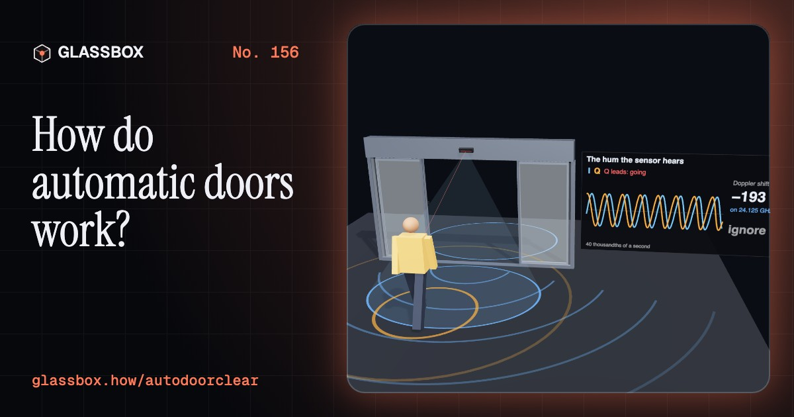
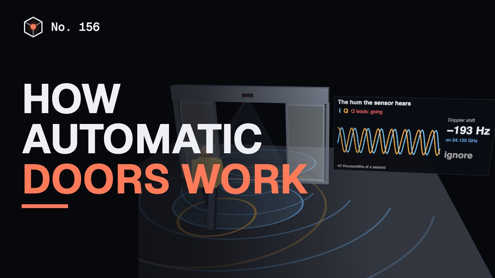
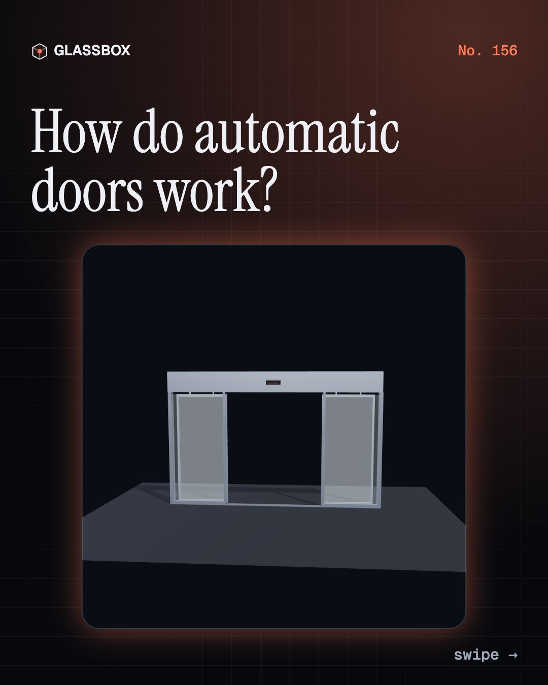
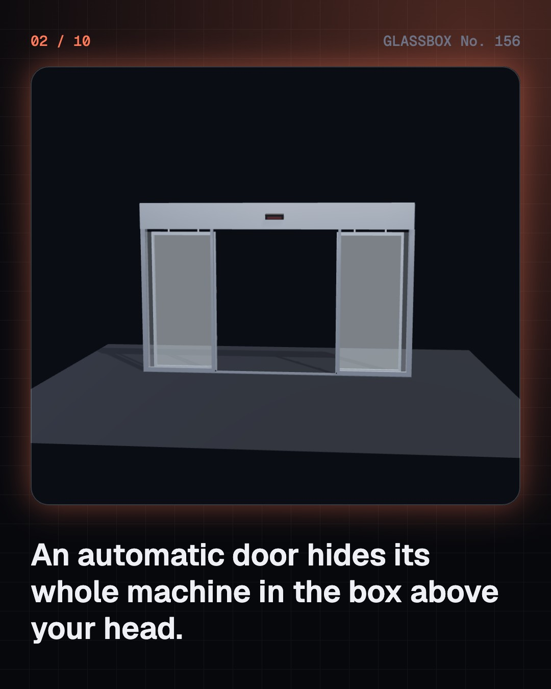
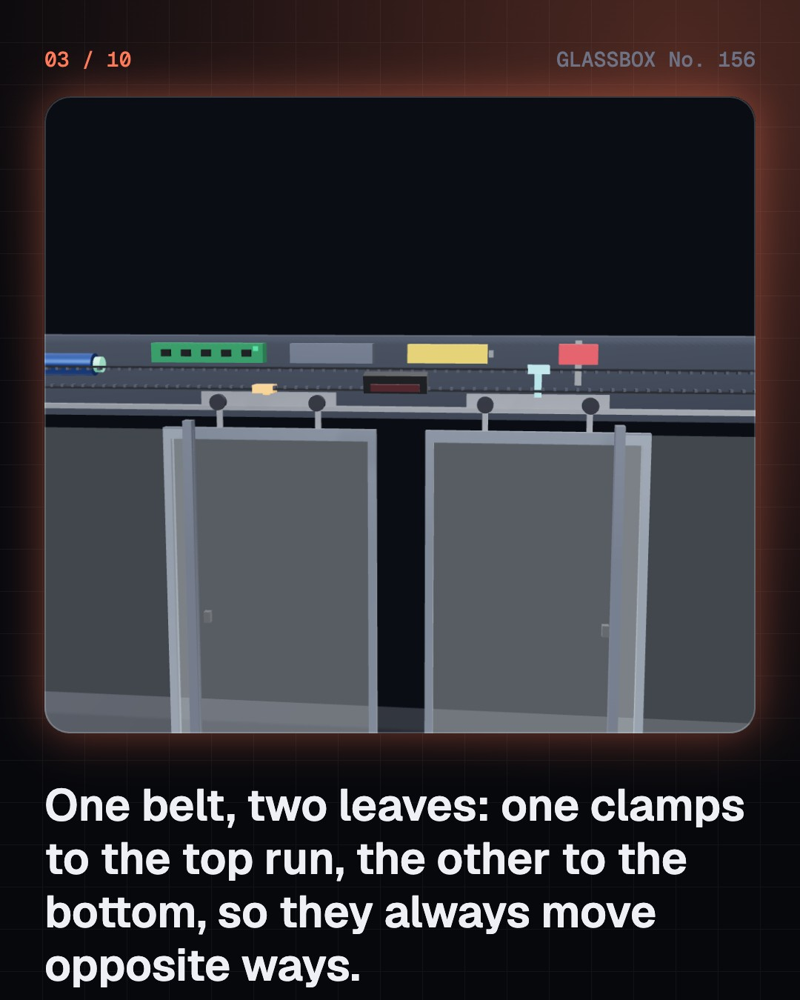
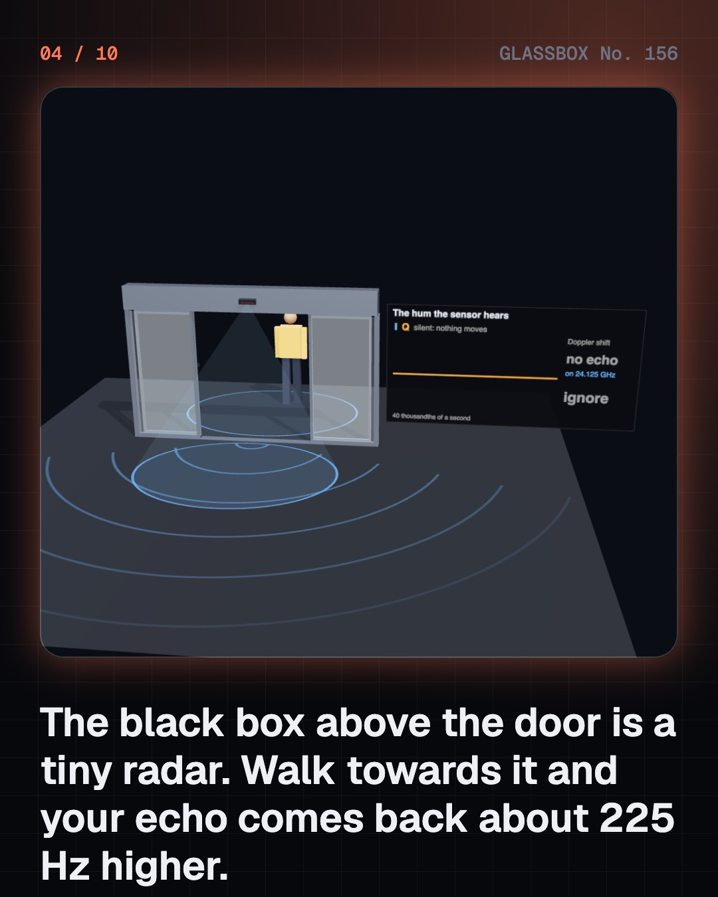

<!-- glassbox:start -->
<!-- Generated from glassbox.json by the Glassbox hub (npm run readme -- autodoorclear). Edit glassbox.json, not this block. -->
<p align="center"><a href="https://glassbox.how/e/autodoorclear/"></a></p>

<h1 align="center">AutoDoorClear</h1>

<p align="center"><b>How do automatic doors work?</b><br>Open up the box above a sliding door: one belt moves two leaves in opposite directions. Walk a figure at the tiny radar that hears your footsteps as a 225 Hz hum, stop in the doorway, stand a bag in the way, cut the power, and see why the glass never shuts on you.</p>

<p align="center"><a href="https://glassbox.how/autodoorclear/"><b>▶ Play with it</b></a> &nbsp;·&nbsp; <a href="https://glassbox.how/e/autodoorclear/">Read the 60-second explainer</a> &nbsp;·&nbsp; <a href="https://glassbox.how/autodoorclear/glassbox/reel.mp4">Watch the 40-second video</a></p>

<p align="center">
  <a href="https://glassbox.how/e/autodoorclear/"></a>
  <a href="https://glassbox.how/e/autodoorclear/"></a>
  <a href="LICENSE"></a>
  <a href="LICENSE-CONTENT.md"></a>
  <a href="#privacy"></a>
</p>

## In 60 seconds

1. **The machine is in the box above your head.** A sliding door's leaves hang from wheeled carriages on a track in the header. A small brushless motor turns a toothed belt that runs round two pulleys. One leaf is clamped to the top run of the belt and the other to the bottom run, and the two runs always move opposite ways, so one motor slides both leaves apart or together.
2. **A tiny radar hears you coming.** The usual sensor is a microwave radar at about 24 GHz. It sends a steady wave and compares the echo with it. Walk towards it at 1.4 m/s and the echo comes back about 225 Hz higher: the Doppler shift, 2 × f × v ÷ c. Two mixers a quarter-wave apart show whether you are coming or going, so a good sensor does not hold the door for people who are leaving.
3. **A curtain of infrared sees you standing.** Radar only detects motion, so a person who stops in the doorway disappears from it. A second, active infrared sensor throws rows of invisible spots on the floor at the threshold and notices when a body covers them, moving or not. Beams across the opening do the same job. Anything seen by any sensor keeps the door open.
4. **Fast in the middle, gentle at the ends.** The controller counts pulses from an encoder on the motor to know where the leaves are, and follows a plan: accelerate, cruise, brake, creep. A 60 kg leaf at 0.3 m/s carries 2.7 joules, and energy grows with the square of speed, which is why standards limit closing speed and force. If a leaf slows when it should not, something is in the way and the motor reverses.
5. **It must never become a wall.** When the mains fails, a battery opens the door and parks it. A fire alarm signal opens it and holds it open. On escape routes the leaves can be pushed to swing outward by hand with no power at all. A fail-safe lock lets go when power is lost; a fail-secure lock stays shut and is only used where there is another way out.
6. **Other doors, other ideas.** A swing-door operator opens a hinged door slowly enough to stop with one hand. A revolving door is an air lock that never offers a draught a straight path. Metro platform screen doors ignore passengers and obey the train, opening only when it has stopped in the right place. A lift's landing door has no motor: the car door grips it and drags it along.

## Words worth knowing

| Term | Meaning |
|---|---|
| **Operator** | The drive unit of an automatic door: motor, gearbox, belt, controller, battery and lock, usually in the header above it. |
| **Microwave motion sensor** | A small radar that detects movement from the Doppler shift of its own echo. |
| **Doppler shift** | The change in a wave's frequency when the thing reflecting it moves towards or away from you. |
| **Presence sensor** | A sensor, usually active infrared, that detects a person who is there even when they are not moving. |
| **Speed profile** | The planned speed of the door along its travel: accelerate, cruise, brake and creep. |
| **Kinetic energy** | The energy of motion, ½ × mass × speed². Safety standards limit how much a moving leaf may carry. |
| **Obstruction reversal** | Re-opening at once when a closing leaf is slowed or stopped by something in its path. |
| **Fail-safe** | Designed so that a failure leaves things safe: for a door on a way out, that means open or free to push open. |
| **Interlock** | A link between two systems so that one cannot act until the other is in a safe state, as with platform doors and trains. |

## A short history

**About 2,000 years from a temple door opened by an altar fire to glass that slides apart for a radar echo.**

- **60** · Temple doors that open by fire (Heron of Alexandria, Alexandria, Roman Egypt)
- **1887** · Lift doors that close themselves (Alexander Miles, Duluth, Minnesota, USA)
- **1888** · The revolving door is patented (Theophilus Van Kannel, Philadelphia, USA)
- **1931** · The Magic Eye door (Horace H. Raymond and Sheldon S. Roby, Stanley Works, West Haven, Connecticut, USA)
- **1942** · A revolving door becomes a trap (Cocoanut Grove nightclub, Boston, USA)
- **1954** · A sliding door for a windy city (Dee Horton and Lew Hewitt, Corpus Christi, Texas, USA)
- **1960** · The sliding door goes on sale (Horton Automatics, Corpus Christi, Texas, USA)
- **1961** · Doors on the platform (Leningrad Metro, Leningrad (now Saint Petersburg), Russia)

The full story, with 30 moments, charts, people and 34 sources: [glassbox.how/e/autodoorclear/history](https://glassbox.how/e/autodoorclear/history/). The data lives in [`history.json`](history.json).

## Video and slides

Made with the Glassbox studio from this box's storyboard (`window.glassbox.director`). Free to reuse under CC BY 4.0.

<a href="https://glassbox.how/autodoorclear/glassbox/video.mp4"></a>

<p><a href="glassbox/slide-1.jpg"></a> <a href="glassbox/slide-2.jpg"></a> <a href="glassbox/slide-3.jpg"></a> <a href="glassbox/slide-4.jpg"></a></p>

| File | What | Size |
|---|---|---|
| [`glassbox/reel.mp4`](https://glassbox.how/autodoorclear/glassbox/reel.mp4) | Reel / Short, with captions and soundtrack | 1080×1920 |
| [`glassbox/video.mp4`](https://glassbox.how/autodoorclear/glassbox/video.mp4) | YouTube video, with captions and soundtrack | 1920×1080 |
| `glassbox/slide-1…10.jpg` | Instagram carousel | 1080×1350 |
| `glassbox/thumb.jpg` | YouTube thumbnail | 1280×720 |
| `glassbox/cover.jpg` | Share card and repo social preview | 1200×630 |
| [`glassbox/history-reel.mp4`](https://glassbox.how/autodoorclear/glassbox/history-reel.mp4) | “History in 10 moments” Reel / Short | 1080×1920 |
| `glassbox/history-slide-*.jpg` | History carousel | 1080×1350 |
| `glassbox/post.json` | Post copy and schedule used by the publish kit | |

## Privacy

This box has no accounts and no ads, and it ships its own fonts and libraries. When you run it yourself it sends nothing anywhere. On glassbox.how, the site's `/bar.js` also loads Glassbox's analytics: **Google Analytics** to count visits (it asks first in the EU, UK and Switzerland, and stays off when your browser sends Global Privacy Control or Do Not Track) and **ClickTrust** to detect bots.

It remembers a few things **in your own browser only**, and never sends them anywhere:

| Browser storage key | What it holds |
|---|---|
| `autodoorclear.v1` | Which chapters you have opened, your best quiz scores, and sound on or off. |

Exactly what each one sees is at [glassbox.how/privacy](https://glassbox.how/privacy/).

## Licences

- **Code:** [MIT](LICENSE). Use it, change it, ship it.
- **Explanations, text, images and videos** (`glassbox.json`, `glassbox/`): [CC BY 4.0](LICENSE-CONTENT.md). Credit “Glassbox, glassbox.how/e/autodoorclear”.
- **Third-party parts** keep their own licences: [three.js](https://threejs.org) (MIT), [Geist, Instrument Serif](https://openfontlicense.org) (SIL OFL 1.1).
- The Glassbox name and logo aren't covered by either licence. See the [terms](https://glassbox.how/terms/).

Found a mistake? [Open an issue](https://github.com/bdeeps/autodoorclear/issues). Corrections happen in public.
<!-- glassbox:end -->

## Run it

It's plain HTML, CSS and JavaScript. No build step and no dependencies. Run locally, it contacts no other website.

```bash
python3 -m http.server 8000
```

Three.js and the fonts ship in `vendor/` and `fonts/`, so it also works offline.

Then open http://localhost:8000.

## How it's built

| File | What |
|---|---|
| `index.html`, `css/app.css` | The page and its styles |
| `js/app.js`, `js/stage.js`, `js/ui.js`, `js/kit.js` | The shared Glassbox 3D engine: chapters, 3D stage, controls, quiz, video director |
| `js/chapters/*.js` | One file per chapter: the 3D model, controls, text, key terms, quiz and video scenes |
| `js/door.js` | Shared parts for this box: the sliding door and its header operator, the walking figure, the Doppler and motion maths with their sources, wave rings and chart boards |
| `glassbox.json` | Title, question, explainer beats, key terms, browser storage and credits shown on glassbox.how |
| `reel` in each chapter | The storyboard the Glassbox studio records into short videos |
| `glassbox/` | The published video, slides, thumbnail and post copy |
| `fonts/`, `vendor/three/` | Self-hosted Geist and Instrument Serif (SIL OFL 1.1) and three.js (MIT) |
